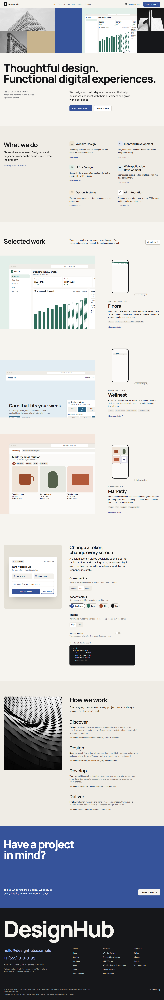
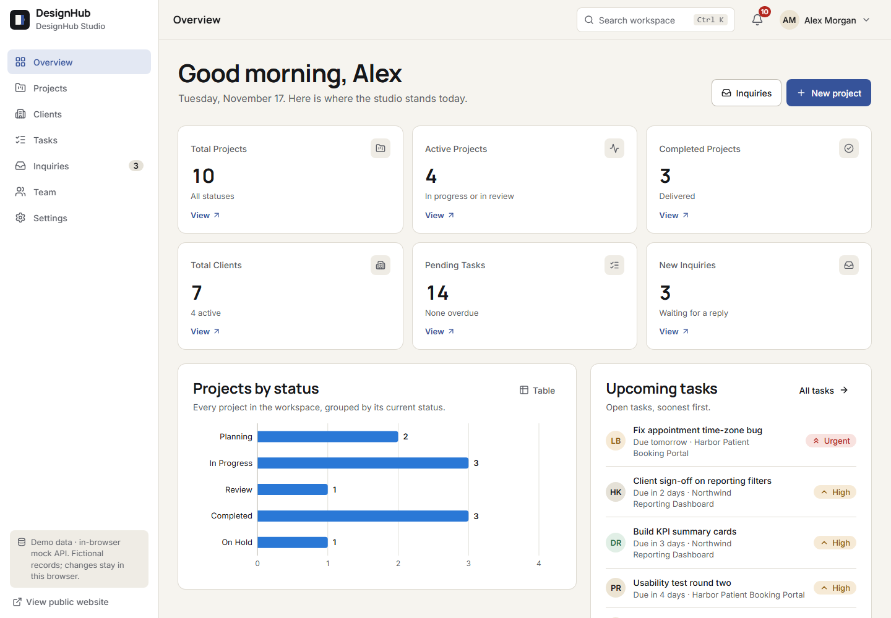
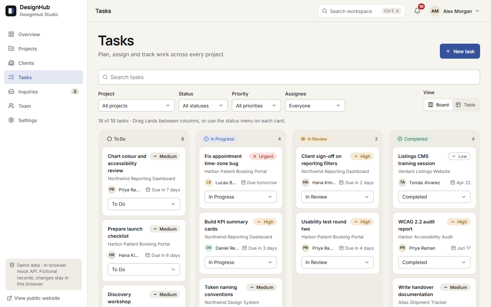
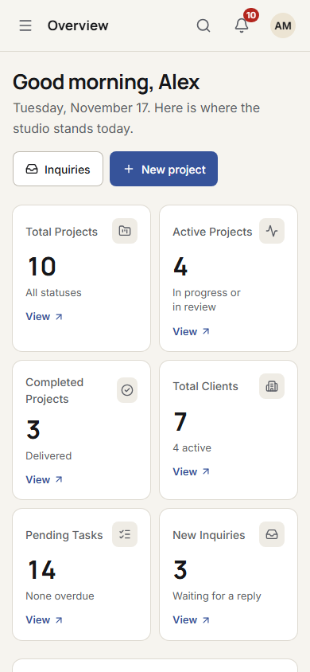

# DesignHub Studio

**A responsive studio website and project workspace, built as a frontend and UI/UX portfolio project.**

DesignHub Studio is a fictional digital design and development studio. The project has two connected experiences:

- **Public website:** home, services, portfolio with working filters, six case studies, about, and a working project-inquiry form.
- **Studio workspace** (`/workspace`): dashboard, projects, clients, tasks (Kanban and table), inquiries, team and settings, with real create, edit and delete.

Inquiries sent from the public contact form appear in the workspace, and every dashboard number is computed from the data.

> All companies, people, projects, emails and phone numbers are **fictional demonstration data**. Emails use the reserved `.example` domain; phone numbers use the 555 range.



| Workspace dashboard | Tasks board | Mobile |
| --- | --- | --- |
|  |  |  |

## Highlights

- **A design system, not just styles.** One token file (colour, type, spacing, radius, shadow, motion) with Tailwind's defaults cleared, so components can only use tokens. 29 reusable components, all shown live at `/design-system`.
- **Accessible by construction.** WCAG 2.2 AA practices throughout: focus-trapped dialogs, WAI-ARIA menus and tabs, labelled controls, announced errors, status that never relies on colour, keyboard alternatives to drag and drop, and reduced-motion support. axe reports **zero violations** on every page, in light and dark themes.
- **Responsive by design.** Verified with no horizontal overflow at 1440, 1280, 1024, 768, 390 and 375px. Phones get their own compositions: a navigation drawer, collapsible filters, bottom-sheet dialogs and a 2-up stat grid.
- **A real data layer.** A centralised API client can talk to an in-browser mock REST API or to an Express + PostgreSQL backend, switched by one environment variable. One shared folder holds the dataset, domain rules and zod schemas, so the frontend and backend always agree.
- **Tested.** 84 Playwright tests (desktop, mobile, real API, responsive sweep, axe) and 20 API tests. They found and fixed 16 real defects, listed in [docs/testing-report.md](docs/testing-report.md).

## Tech stack

| Area | Tools |
| --- | --- |
| Frontend | React 19, Vite 8, JavaScript, Tailwind CSS 4, React Router 8, Recharts 3, React Hook Form + Zod 4, Lucide React |
| Backend | Node.js 24, Express 5, PostgreSQL (pg), Zod |
| Testing | Playwright 1.65, @axe-core/playwright, node:test + Supertest |
| Infrastructure | Docker, Docker Compose, nginx (static hosting with SPA fallback) |
| Design | Design tokens + `docs/figma-handoff.md` (no Figma file was created; see below) |

## Getting started

Requirements: **Node.js 22.22+** (developed on 24.17). The default mode needs nothing else.

```bash
npm install
```

```bash
npm run dev
```

Open http://localhost:5173. The app runs on the **in-browser mock API**: your changes persist in this browser's localStorage, and *Settings → Demo data → Reset demo data* restores the seed.

**Workspace demo access:** open `/workspace`, then press **Use demo credentials** (`demo@designhub.example` / `studio-demo-2026`). This is a client-side demo gate, clearly labelled as such, and **not real authentication**. No password is stored.

### Run with the Express API

```bash
npm run dev:api
```

The API starts on http://localhost:5000/api with the **memory driver** (no database needed). Then start the frontend against it:

```bash
cd frontend && VITE_DATA_SOURCE=api npm run dev
```

On Windows PowerShell, set the variable first with `$env:VITE_DATA_SOURCE="api"`, or copy `.env.example` to `frontend/.env`.

### Run the full stack with PostgreSQL (Docker)

```bash
docker compose up --build
```

- Web: http://localhost:8080
- API: http://localhost:5000/api
- PostgreSQL: localhost:5432

The API container applies `database/migrations` and loads the seed on start. *(The Compose stack was written but not executed during development, because Docker's daemon was unavailable. See the testing report.)*

Without Docker, against your own PostgreSQL: set `DB_DRIVER=postgres` and `DATABASE_URL` in `backend/.env`, then:

```bash
npm run db:migrate -w backend
```

```bash
npm run db:seed -w backend
```

## Scripts

| Command | What it does |
| --- | --- |
| `npm run dev` | Frontend dev server (mock API) |
| `npm run dev:api` | Express API with file watching |
| `npm run build` / `npm run preview` | Production build / preview it |
| `npm run test:api` | Backend API tests |
| `npm run test:e2e` | All Playwright suites (starts its own servers) |

## Project structure

```
frontend/   React app — src/{components,pages,layouts,hooks,services,context,data,styles}, tests/e2e
backend/    Express API — src/{config,database,middleware,modules,routes,services,utils}, tests
shared/     demo-data.json, domain.js (rules, dashboard summary), schemas.js (zod)
database/   migrations/001_initial_schema.sql, seeds/README.md
docs/       architecture, design system, responsive, API, Figma handoff, testing report, screenshots
```

## Documentation

- [Architecture](docs/architecture.md): structure, data flow and key decisions
- [Design system](docs/design-system.md): tokens, components and rules
- [Responsive guidelines](docs/responsive-guidelines.md)
- [API documentation](docs/api-documentation.md)
- [Figma handoff](docs/figma-handoff.md): frames, variables and per-screen specs
- [Testing report](docs/testing-report.md): results, coverage, defects fixed and limitations

## Recording a demo video (about 3 minutes)

1. Run `npm run dev`. Open the home page at 1440px wide in a clean browser profile.
2. **Public (60s):** scroll the home page; change the token playground (radius, accent, dark); open *Our Work*, filter by *Website Design*, search "postgresql", open a case study.
3. **Contact (30s):** submit the empty form to show validation, then send a valid inquiry and show the success panel.
4. **Workspace (75s):** follow *See it in the workspace*; show the new inquiry and change its status; on Overview, point out that the numbers match; create a project; drag a task across the board, then move one with its status menu (the keyboard path); switch to dark mode in Settings.
5. **Responsive (15s):** use DevTools device mode at 390px; open the mobile menu and the workspace drawer.
6. Finish on `/design-system`.

Record with OBS or the OS screen recorder at 1080p and 30fps; trim pauses. Mention that the data is fictional.

## Known limitations

- Demo access is client-side only. Real authentication, authorisation and API rate limiting would be required before handling real data.
- The PostgreSQL repository and Docker setup are implemented but were not run in this environment.
- Automated tests run in Chromium only, and no manual screen-reader testing has been done.
- Portfolio previews are interfaces drawn in code, not screenshots of real products. Atmosphere photographs are by Julien Moreau, Carl Nenzen Loven, Samuel Zeller and Anthony Delanoix (Unsplash licence), stored locally and credited in the footer.
